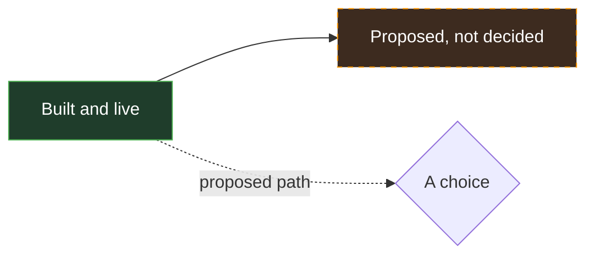
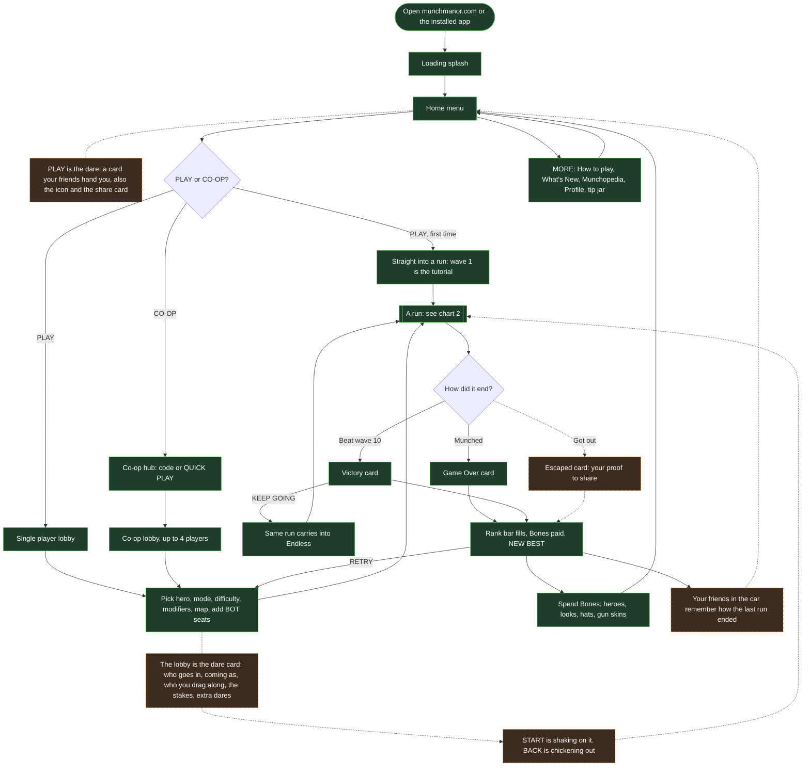
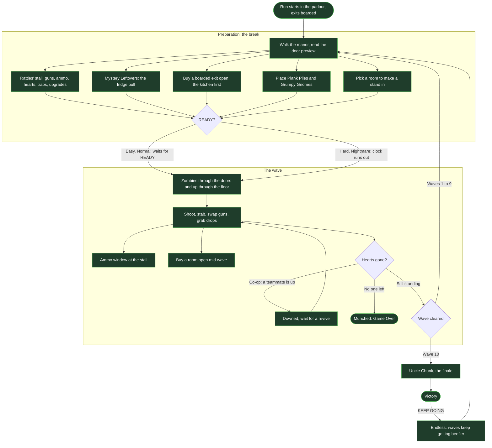
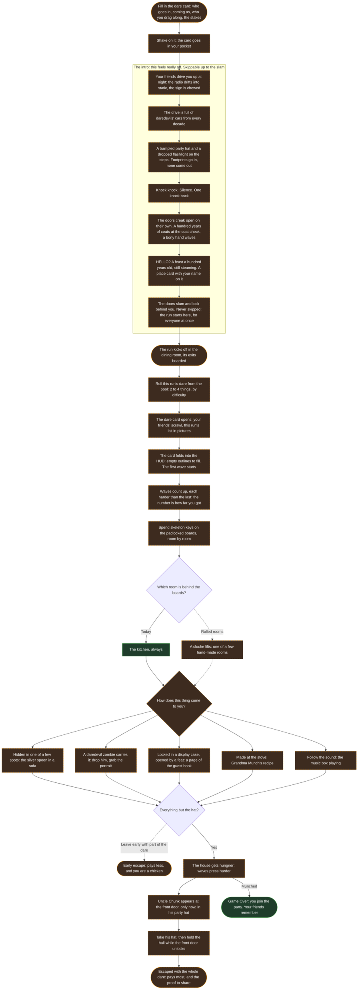
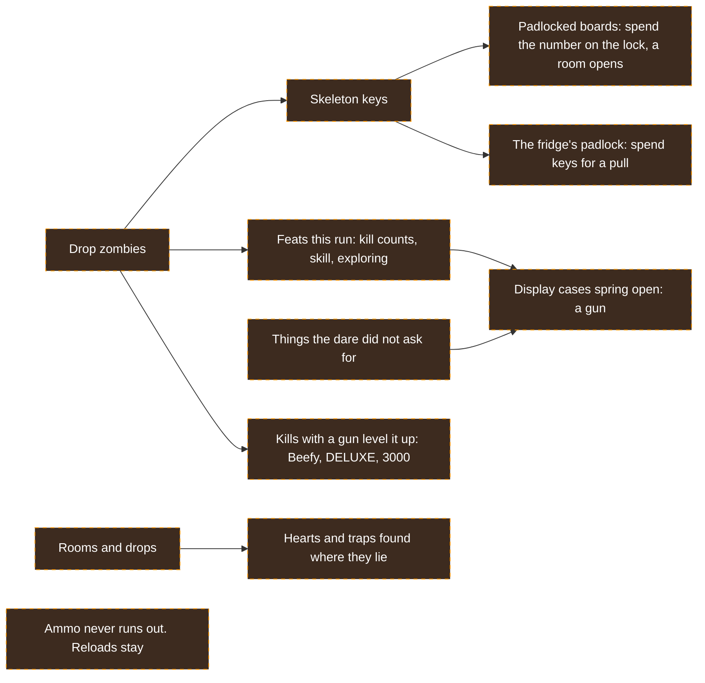
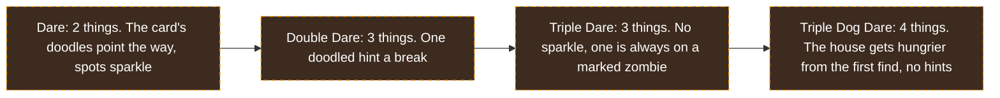
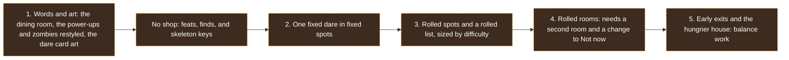

# Flow

The game's vision as flow charts, to plan and talk through with collaborators. It draws from [`GAME_DESIGN.md`](./GAME_DESIGN.md) (what is decided and built) and [`LORE.md`](./LORE.md) (the escape the manor direction, still a proposal). When a chart and those docs disagree, the docs win: fix the chart.

The charts are Mermaid, so GitHub draws them. Every chart uses the same key:

## 1. A session, from the link to the next run

Everything a player passes through, start to finish.

## 2. A run: breaks and waves

The core loop: Preparation, then a wave, then Preparation again, until the player dies or wins.

## 3. Escape the manor (proposed)

The direction in `LORE.md`, chosen 2026-11-10: the Munch Manor dare. A hundred years ago the Munches threw a dinner party, the doors shut, and nobody came out. You are dared to go in, bring back proof, and get out. The party never ended: Uncle Chunk is still the host, the zombies are his guests and every daredevil who failed, and Rattles took the dare in 1924. The waves stay as the pressure, so a player who ignores the hunt still plays chart 2.

### No shop: how you get stronger

There is no shopkeeper. You get stronger from the house itself, and zombies drop skeleton keys, the one thing you count. Ammo never runs out, but magazines and reloads stay.

### Power-ups are the house's things

Each power-up becomes something you would find in an old manor, and its look on you matches it. Same rules as today; the zombies drop them because the daredevils pocketed them as proof.

| Today           | In the manor  | What it does                     | How it looks on you                           |
| --------------- | ------------- | -------------------------------- | --------------------------------------------- |
| Hot Sauce       | Wind-Up Key   | Rapid fire, never reloads        | A brass key turns in your back, gears tick    |
| Mean Beans      | Family Silver | Twice the damage, more knockback | A silver gleam, shots fly as silver streaks   |
| Zoomy Socks     | Dancing Shoes | Runs 1.4 times as fast           | Music notes and sparkly footprints            |
| Shish Kebullets | Hat Pins      | Shots go through 3 zombies       | A ring of pins circles you, shots fly as pins |
| Big Burp        | Dinner Gong   | A shove all around you           | A gong appears and BONG: a ring of sound      |
| Pickled Heart   | Pickled Heart | One heart                        | Stays: a jar from the curiosity cabinet       |

### Difficulty sets the list

Today the four levels scale only the zombies (health, speed, bites) and the break clock. The escape adds a second dial: how much you have to find, and how hard the house hides it. Uncle Chunk's party hat is always the last thing on every list: he shows up at the front door wearing it only once the rest is found, never at a set wave.

### The order it would land in

From `LORE.md`, cheapest first, so the story lands before the systems do.

## Open questions to settle together

The lore choices that most change these charts, from `LORE.md`:

1. What goes in the pool of things the dare asks for, and how does each one come to you?
2. What does Rattles say now? He stays as the 1924 daredevil who gives hints.
3. Which feats open which display cases, and how many skeleton keys a room and a fridge pull cost?
4. Do rooms roll, or only what is in them?

The build is planned in [`docs/ESCAPE_PLAN.md`](./docs/ESCAPE_PLAN.md). Settled on 2026-11-10: no shop (feats open display cases, guns level up with use, zombies drop skeleton keys for rooms and the fridge); endless ammo with reloads kept; your friends write the dare card; the power-ups become the house's things; the difficulty levels are Dare, Double Dare, Triple Dare, and Triple Dog Dare; the dining room is a brand-new room.
