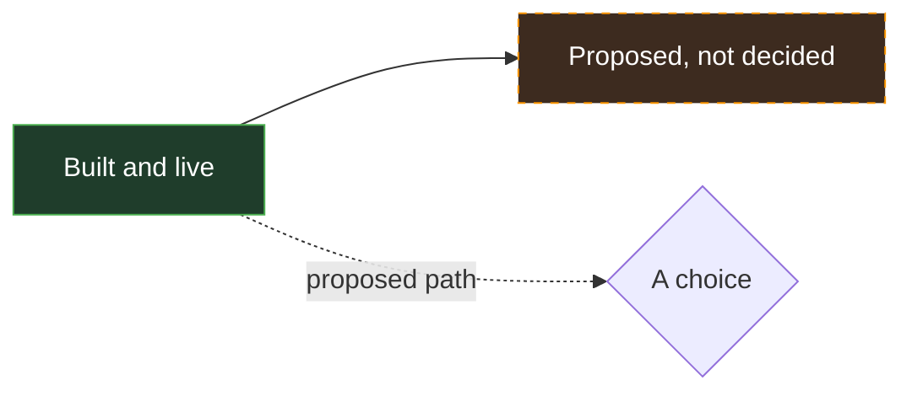
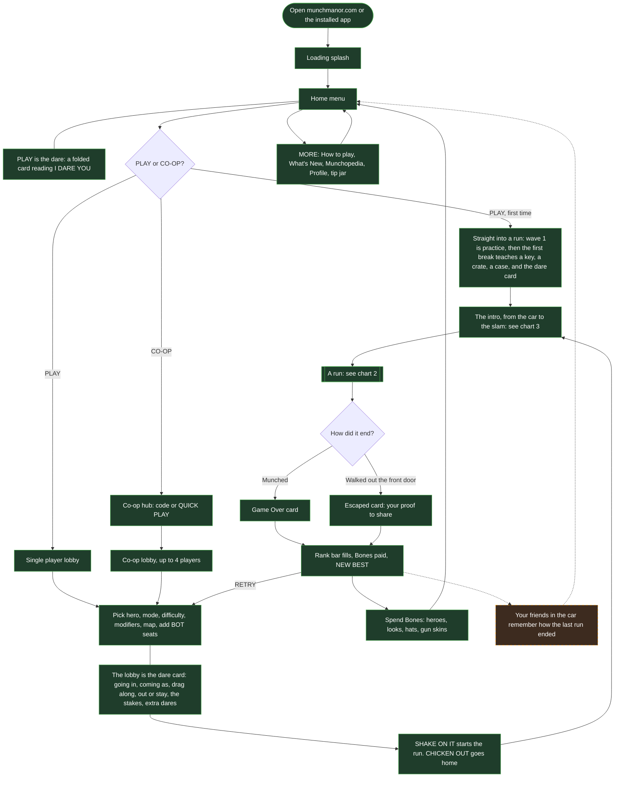
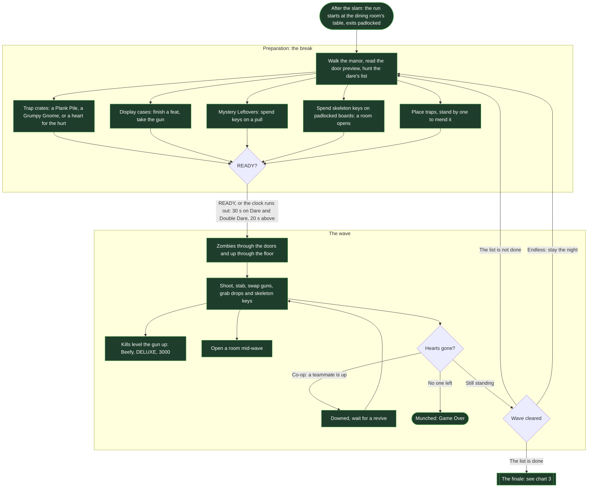
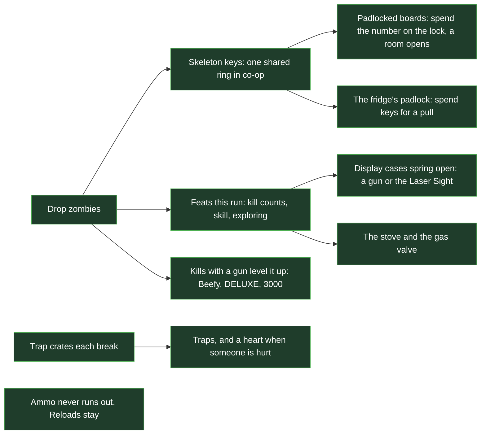
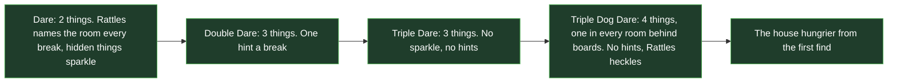
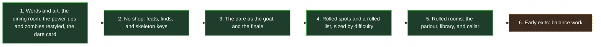

# Flow

The game's vision as flow charts, to plan and talk through with collaborators. It draws from [`GAME_DESIGN.md`](./GAME_DESIGN.md) (what is decided and built) and [`LORE.md`](./LORE.md) (the story). The escape the manor update was built on 2026-11-10 (see "Escape the manor" in `GAME_DESIGN.md`), so most of chart 3 is built now; what is left proposed is marked. When a chart and those docs disagree, the docs win: fix the chart.

The charts are Mermaid, so GitHub draws them. Every chart uses the same key:

## 1. A session, from the link to the next run

Everything a player passes through, start to finish.

## 2. A run: breaks and waves

The core loop: Preparation, then a wave, then Preparation again, until the crew walks out the front door or is munched. Since 2026-11-10 there is no shop and no fixed wave count.

## 3. Escape the manor

The direction in `LORE.md`, chosen 2026-11-10 and built the same week: the Munch Manor dare. A hundred years ago the Munches threw a dinner party, the doors shut, and nobody came out. You are dared to go in, bring back proof, and get out. The party never ended: Uncle Chunk is still the host, the zombies are his guests and every daredevil who failed, and Rattles took the dare in 1924. The waves stay as the pressure, so a player who ignores the hunt still plays chart 2.

```mermaid
flowchart TD
  dare([Fill in the dare card: going in, coming as, drag along, the stakes]):::built --> shake
  shake[Shake on it]:::built --> car

  subgraph Intro [The intro: this feels really off. Skippable up to the slam]
    car[Your friends drive you up at night: the radio drifts into static, the sign is chewed]:::built --> arrive2[The drive is full of daredevils' cars from every decade]:::built
    arrive2 --> walk[A trampled party hat and a dropped flashlight on the steps]:::built
    walk --> knock[Knock knock. Silence. One knock back]:::built
    knock --> opens[The doors creak open. A hundred years of coats at the coat check, a bony hand waves]:::built
    opens --> hello[HELLO? A feast a hundred years old. A place card with your name on it]:::built
    hello --> door[The doors slam and lock behind you. Never skipped: the run starts here, for everyone at once]:::built
  end

  door --> arrive
  arrive([The run kicks off at the dining room's table, its exits padlocked]):::built --> list

  list[Roll this run's dare: 2 to 4 rooms behind boards, one thing in each, by difficulty]:::built --> pocket
  pocket[The dare card opens from your pocket: your friends' scrawl]:::built --> fold
  fold[The dare card on the HUD: empty outlines to fill]:::built --> waves
  waves[Waves count up, each harder than the last: the number is how far you got]:::built --> explore

  explore[Spend skeleton keys on the padlocked boards, room by room]:::built --> roomRoll{Which room is behind the boards?}
  roomRoll -->|North| fixedRoom[The kitchen, always]:::built
  roomRoll -->|The other three slots| dish[A cloche lifts: the parlour, the library, or the cellar, rolled each run]:::built

  fixedRoom --> hunt
  dish --> hunt

  hunt[Each room holds one thing: find it in the room you opened]:::built
  hunt --> anyThing[Any thing in any room, rolled each run: the recipe, the spoon, the bell, the music box, the portrait, or a guest book page]:::built

  anyThing --> all
  all{Everything but the hat?}

  all -.->|Leave early with part of the dare| early([Early escape: pays less, and you are a chicken]):::proposed
  all -->|Yes| hungry[The house gets hungrier: more zombies]:::built
  hungry --> goodbye[Uncle Chunk comes through the front door, in his party hat, at the next wave: never before wave 6 to 9 by difficulty]:::built
  goodbye --> holdout[Take his hat, then hold the hall while the front door unlocks]:::built
  holdout --> doorMark[A door out of view gets a marker at the screen's edge]:::built
  doorMark --> escaped([Walk out together: Escaped, and the proof to share]):::built

  hungry -->|Munched| lost([Game Over: you join the party]):::built

  classDef built fill:#1f3d2b,stroke:#4caf50,color:#fff
  classDef proposed fill:#3d2b1f,stroke:#ff9800,color:#fff,stroke-dasharray: 5 5
```

### No shop: how you get stronger

There is no shopkeeper. You get stronger from the house itself, and zombies drop skeleton keys, the one thing you count. Ammo never runs out, but magazines and reloads stay.

### Power-ups are the house's things

Built on 2026-11-10. Each power-up is something you would find in an old manor, and its look on you matches it. Same rules as before; the zombies drop them because the daredevils pocketed them as proof.

| Before          | In the manor  | What it does                     | How it looks on you                           |
| --------------- | ------------- | -------------------------------- | --------------------------------------------- |
| Hot Sauce       | Wind-Up Key   | Rapid fire, never reloads        | A brass key turns in your back, gears tick    |
| Mean Beans      | Family Silver | Twice the damage, more knockback | A silver gleam, shots fly as silver streaks   |
| Zoomy Socks     | Dancing Shoes | Runs 1.4 times as fast           | Music notes and sparkly footprints            |
| Shish Kebullets | Hat Pins      | Shots go through 3 zombies       | A ring of pins circles you, shots fly as pins |
| Big Burp        | Dinner Gong   | A shove all around you           | A gong appears and BONG: a ring of sound      |
| Pickled Heart   | Pickled Heart | One heart                        | Stays: a jar from the curiosity cabinet       |

### Difficulty sets the list

The four levels scale the zombies (health, speed, bites) and the break clock, and since 2026-11-10 they also set how much you have to find and how much Rattles helps. Uncle Chunk's party hat is always the last thing on every list: he comes through the front door wearing it only once the rest is found, at the next wave, but never before wave 6 on Dare, 8 on Double Dare, or 9 on Triple Dare and Triple Dog Dare.

### The order it landed in

From `LORE.md`, cheapest first. Everything but early exits landed in one update (see `docs/ESCAPE_PLAN.md`).

## Open questions to settle together

The lore choices still open, from `LORE.md`:

1. Which more things join the rooms, and which room each fits.
2. Rattles' lines and his 1924 look.
3. The feat pools per difficulty and the key costs, tuned in the balance pass.
4. Leaving early, and what your friends in the car say between runs.

The build is in [`docs/ESCAPE_PLAN.md`](./docs/ESCAPE_PLAN.md). Settled and built on 2026-11-10: no shop (feats open display cases, guns level up with kills, zombies drop skeleton keys for rooms and the fridge); endless ammo with reloads kept; your friends write the dare card; the power-ups are the house's things; the difficulty levels are Dare, Double Dare, Triple Dare, and Triple Dog Dare; the dining room is a brand-new room; the parlour, the library, and the cellar roll into the house's slots.
