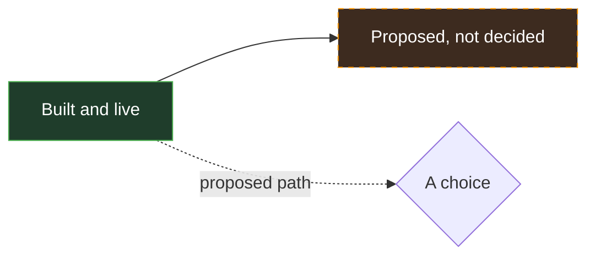
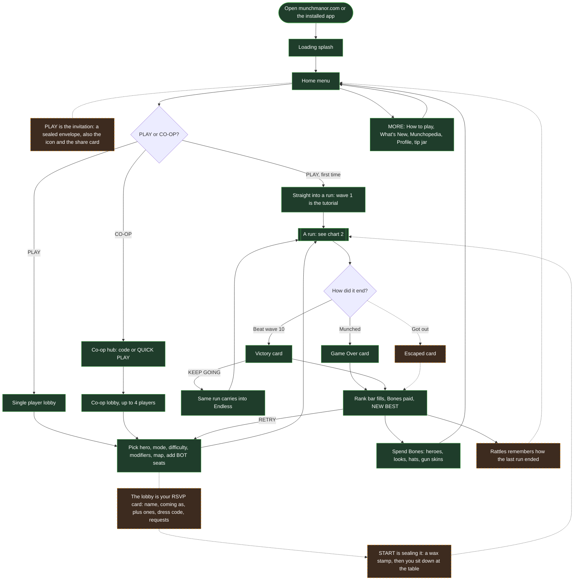
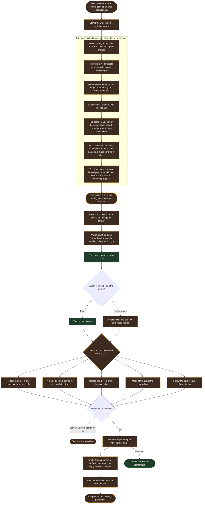
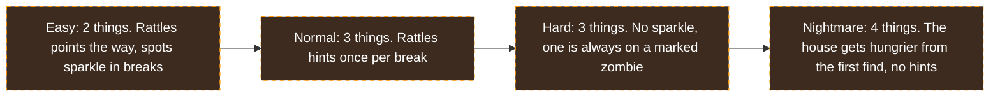
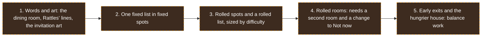

# Flow

The game's vision as flow charts, to plan and talk through with collaborators. It draws from [`GAME_DESIGN.md`](./GAME_DESIGN.md) (what is decided and built) and [`LORE.md`](./LORE.md) (the escape the manor direction, still a proposal). When a chart and those docs disagree, the docs win: fix the chart.

The charts are Mermaid, so GitHub draws them. Every chart uses the same key:

## 1. A session, from the link to the next run

Everything a player passes through, start to finish.

## 2. A run: breaks and waves

The core loop: Preparation, then a wave, then Preparation again, until the player dies or wins.

## 3. Escape the manor (proposed)

The direction in `LORE.md`: you came to dinner and you are the main course. You fill in your RSVP, a cutscene drives your crew up to the manor and the doors slam behind you, the run kicks off in the dining room with its exits boarded as today, and this run's list of what you need to leave is rolled from a pool, longer the harder the difficulty. The waves stay as the pressure, so a player who ignores the hunt still plays chart 2. Nothing here is decided.

### Difficulty sets the list

Today the four levels scale only the zombies (health, speed, bites) and the break clock. The escape adds a second dial: how much you have to find, and how hard the house hides it. Uncle Chunk's goodbye is always the last thing on every list: he shows up at the front door only once the rest is found, never at a set wave.

### The order it would land in

From `LORE.md`, cheapest first, so the story lands before the systems do.

## Open questions to settle together

The lore choices that most change these charts, from `LORE.md`:

1. Why are you in the manor: invited, broke in, inherited it, or woke up there?
2. Who are the zombies, and does Uncle Chunk lead them?
3. Who is Rattles: the butler, a past guest, the first owner, or the house's own salesman?
4. What locks you in: Uncle Chunk, the house, a curse, or Rattles?
5. What goes in the pool of things to leave with, and how does each one come back to you?
6. Is the dining room the parlour redressed, or a new room?
7. Do rooms roll, or only what is in them?
